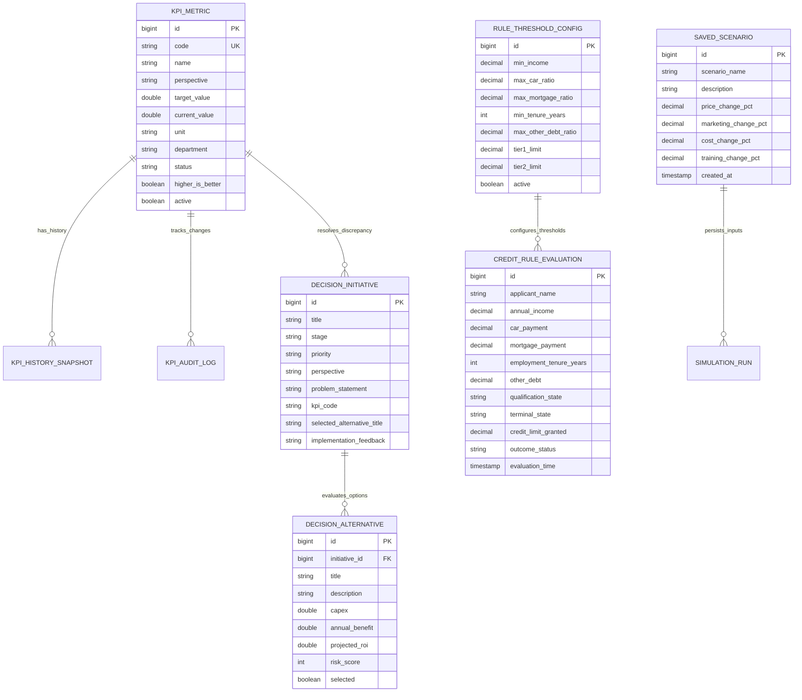

# StratOps 360 &mdash; Enterprise Balanced Scorecard & Decision Support MIS

**StratOps 360** is a full-featured Management Information System (MIS) enterprise web platform engineered in **Java 21** and **Spring Boot 3.3.4**. It directly implements core concepts from Kenneth C. Laudon and Herbert A. Simon's MIS curriculum, bridging theoretical management frameworks with live enterprise business logic, interactive simulations, and rule-based inference engines.

---

## 🏛️ MIS Theoretical Frameworks Directly Implemented

### 1. Herbert Simon’s 4 Stages of Decision Making (Slide 11)
*Located at `/decision/pipeline` and `/decision/view/{id}`:*
* **Stage 1 &mdash; Intelligence (Problem Discovery):** Automated detection of discrepancies between real-world operational telemetry and strategic target SLAs.
* **Stage 2 &mdash; Design (Solution Formulation):** Multi-alternative modeling with pros, cons, risk scores ($1\text{–}10$), capex budgeting, and projected ROI.
* **Stage 3 &mdash; Choice (Selecting Solutions):** ROI and risk sensitivity evaluation comparing competing alternatives using **Risk-Adjusted Score** ($\text{ROI} / \text{Risk}$) to select the optimal strategy.
* **Stage 4 &mdash; Implementation &amp; Feedback Loop:** Real-world tracking of post-launch metrics to verify whether the solution successfully resolved the initial discrepancy.
* **Enforced Transition Guards:**
  * Cannot advance from Design to Choice without at least 2 formulated alternatives.
  * Cannot advance to Implementation without an approved, selected winning alternative.
  * Cannot close an initiative without documenting empirical operational feedback (closing the cybernetic loop).

### 2. The Balanced Scorecard Framework (Slides 13&ndash;14)
*Located at `/dashboard` and `/perspective/{perspective}`:*
Operationalizes corporate strategy across **Robert Kaplan and David Norton's four dimensions**:
1. **Financial Perspective:** *Operating Profit Margin, Annual Net Profit, ROCE, Operational Cash Flow.*
2. **Customer Perspective:** *Retention Rate, Net Promoter Score (NPS), Delivery SLA, Customer Acquisition Cost (CAC).*
3. **Internal Business Processes:** *Order Fulfillment Cycle Time, Manufacturing Defect Ratio, Equipment Downtime, Resource Utilization.*
4. **Learning and Growth:** *Training Hours per Employee, Employee Turnover, Internal Promotion Rate, Digital Tool Adoption.*
* Includes **period filtering** (`2025-Q3` through `2026-Q2`), cross-perspective **Radar Alignment Chart**, multi-quarter trend sparklines, and full KPI CRUD governance with historical audit logs (`/kpi/new`, `/kpi/edit/{id}`).

### 3. Three-Tier Management Hierarchy & Role-Based Access Control (Slide 10)
Toggled via the top navigation bar's **View as** selector:
* **Senior Management (Executive / ESS):**
  * *Access Level:* Strategic Level (Executive Support System).
  * *Capabilities:* Macro Balanced Scorecard overview, cross-perspective radar alignment, What-If simulation forecasting, and long-term scenario planning.
* **Middle Management (Manager / MIS & DSS):**
  * *Access Level:* Tactical Level (Management Information & Decision Support System).
  * *Capabilities:* Full tactical administration: modifying KPI target thresholds (`/kpi/edit/{id}`), creating new metrics (`/kpi/new`), managing the Herbert Simon 4-stage decision pipeline (`/decision/*`), formulating alternatives, and tuning expert system inference thresholds (`/expert-system/thresholds`).
* **Operational Management (Operations / TPS - Restricted Access):**
  * *Access Level:* Operational Level (Transaction Processing System).
  * *Capabilities:* Real-time telemetry monitoring, routine applicant financial fact entry for credit evaluation.
  * *Enforced Restrictions:* **Strictly locked** from altering scorecard KPI targets or creating new metrics, advancing Simon decision stages or adding alternatives, modifying expert engine rule thresholds, or saving simulation scenarios. Displays prominent red TPS warning banners and `🔒 Locked` indicators across the UI. Backend security guards reject direct URL tampering.

### 4. Operational Expert System with Forward Chaining (Slides 8&ndash;9)
*Located at `/expert-system`:*
Direct implementation of the **Credit Granting Flowchart (Slide 9)** using an extensible `CreditRule` engine:
* `Rule A -> B`: Income threshold check ($>\$50,000$).
* `Rule B -> C`: Annual car debt ceiling check ($<10\%$).
* `Rule C -> D`: Annual mortgage debt ceiling check ($<20\%$) $\rightarrow$ *State D (Credit Qualified)*.
* `Rule E -> F`: Tenure check ($\ge 4\text{ years}$) $\rightarrow$ *State F (\$10,000 Line Granted)*.
* `Rule G -> H -> F / I`: Secondary debt evaluation ($<5\%$) $\rightarrow$ *State F (\$10,000) or State I (\$3,000 Restricted Limit)*.
* **Dynamic Features:** Interactive SVG Credit Flowchart with real-time CSS firing-path highlighting, paginated evaluation audit history, CSV streaming export, and an administrative threshold configuration panel (`/expert-system/thresholds`).

### 5. Business Intelligence (BI) Capabilities (Slide 12)
*Located at `/reports` and `/perspective/{perspective}`:*
* **Drill-Down Capability:** Click any metric to inspect department-level historical time-series trends.
* **Parameterized Reports:** Multi-dimensional filtering by Department, Perspective, and Status with live summary metrics.
* **Tabular Data Export:** One-click CSV export streaming formatted enterprise records.

---

## 📐 System Architecture Diagram

```
                     ┌────────────────────────────────────────────────────────┐
                     │                     USER BROWSER                       │
                     │   Calm Editorial UI | Local Chart.js | Inter | Tour    │
                     └───────────────────────────┬────────────────────────────┘
                                                 │ HTTP / REST
                                                 ▼
┌─────────────────────────────────────────────────────────────────────────────────────────────┐
│                             SPRING BOOT 3.3.4 APPLICATION LAYER                            │
│                                                                                             │
│  ┌────────────────────────┐  ┌────────────────────────┐  ┌───────────────────────────────┐  │
│  │     WEB CONTROLLERS    │  │     REST API LAYER     │  │     SECURITY & EXCEPTIONS     │  │
│  │  DashboardController   │  │    RestApiController   │  │        SecurityConfig         │  │
│  │   DecisionController   │  │   (/api/v1/...,        │  │    GlobalExceptionHandler     │  │
│  │  SimulationController  │  │    /swagger-ui.html)   │  │   (Custom 404 / 500 Pages)    │  │
│  │  ExpertSystemController│  └───────────┬────────────┘  └───────────────┬───────────────┘  │
│  │    ReportsController   │              │                               │                  │
│  └───────────┬────────────┘              │                               │                  │
│              └───────────────────────────┼───────────────────────────────┘                  │
│                                          ▼                                                  │
│  ┌───────────────────────────────────────────────────────────────────────────────────────┐  │
│  │                                    SERVICE LAYER                                      │  │
│  │   KpiService         │ DecisionService      │ SimulationService │ ExpertSystemEngine  │  │
│  │   (Spring Cache)     │ (Stage Guards)       │ (What-If Model)   │ (Forward Chaining)  │  │
│  └───────────────────────────────────────┬───────────────────────────────────────────────┘  │
│                                          │                                                  │
│                                          ▼                                                  │
│  ┌───────────────────────────────────────────────────────────────────────────────────────┐  │
│  │                                 RULE ENGINE SUBSYSTEM                                 │  │
│  │  CreditRule Interface │ EvaluationContext │ InferenceStep Trace │ Rule Implementations│  │
│  └───────────────────────────────────────┬───────────────────────────────────────────────┘  │
│                                          │                                                  │
│                                          ▼                                                  │
│  ┌───────────────────────────────────────────────────────────────────────────────────────┐  │
│  │                               SPRING DATA JPA REPOSITORIES                            │  │
│  │  KpiMetricRepository         │ DecisionInitiativeRepository │ SavedScenarioRepository │  │
│  │  KpiAuditLogRepository       │ CreditRuleEvaluationRepo     │ RuleThresholdConfigRepo │  │
│  └───────────────────────────────────────┬───────────────────────────────────────────────┘  │
└──────────────────────────────────────────┼──────────────────────────────────────────────────┘
                                           │
                                           ▼
┌─────────────────────────────────────────────────────────────────────────────────────────────┐
│                               DATABASE LAYER (H2 DATABASE)                                  │
│         dev profile: jdbc:h2:mem:stratopsdb  |  prod profile: jdbc:h2:file:./data/          │
└─────────────────────────────────────────────────────────────────────────────────────────────┘
```

---

## 🗄️ Database Entity-Relationship (ER) Diagram



---

## 🛠️ Technology Stack

* **Language & Runtime:** Java 21 (Eclipse Temurin)
* **Framework:** Spring Boot 3.3.4
  * Spring Web (MVC)
  * Spring Data JPA & Hibernate 6.5
  * Spring Security (CSRF Protection, Security Headers)
  * Spring Cache (Scorecard Aggregations)
  * Spring Boot Actuator (`/actuator/health`, `/actuator/info`)
  * Spring Boot Validation (Jakarta Bean Validation)
* **API Documentation:** SpringDoc OpenAPI 2.6.0 (Swagger UI at `/swagger-ui.html`)
* **Template Engine:** Thymeleaf 3 with reusable fragments
* **Database:** H2 Embedded (In-Memory for `dev`, File-backed for `prod`)
* **Frontend:** Bootstrap 5.3, FontAwesome 6.4.2, Google Plus Jakarta Sans font
* **Data Visualizations:** Chart.js 4.4.1 (Dynamic radar alignment chart, multi-quarter trendlines)
* **Build & DevOps:** Apache Maven 3.9+, Multi-stage Docker, Docker Compose, GitHub Actions CI

---

## 🚀 Running the Application

### Option 1: Run Locally via Maven (Recommended for Viva)

#### Prerequisites
* **Java JDK 21+** (`java -version`)
* **Apache Maven 3.8+** (`mvn -v`)

#### Execution Steps
1. Navigate to the project root directory:
   ```bash
   cd stratops360
   ```
2. Build and launch the application:
   ```bash
   mvn spring-boot:run
   ```
3. Open your browser and navigate to:
   ```text
   http://localhost:8080
   ```

---

### Option 2: Run via Docker Compose

```bash
docker-compose up --build -d
```
The application will boot in the production profile and be accessible at `http://localhost:8080`.

---

## 🗺️ Application Web Routes

| Route | Role / Purpose | MIS Academic Concept |
|---|---|---|
| `http://localhost:8080/` or `/dashboard` | Executive Balanced Scorecard (ESS) with Period Filtering & Radar Chart | Unit 5 Slides 10, 13&ndash;14 |
| `http://localhost:8080/kpi/new` | Create New KPI Metric with Bean Validation | Strategic KPI Formulation |
| `http://localhost:8080/kpi/edit/{id}` | Edit KPI Metric with Historical Revision Audit Trail | Enterprise Data Governance |
| `http://localhost:8080/decision/pipeline` | Herbert Simon 4-Stage Decision Board with Transition Guards | Unit 5 Slide 11 |
| `http://localhost:8080/decision/new` | Stage 1 (Intelligence): Formulate Discrepancy & Opportunity | Unit 5 Slide 11 |
| `http://localhost:8080/decision/view/{id}` | Stages 2&ndash;4: Formulate Alternatives, Risk-Adjusted ROI, Feedback Loop | Unit 5 Slide 11 |
| `http://localhost:8080/simulation` | What-If Sensitivity DSS Simulator with Scenario Persistence | Unit 5 Slide 12 |
| `http://localhost:8080/simulation/compare` | Multi-Scenario Side-by-Side Comparison Matrix | Unit 5 Slide 12 |
| `http://localhost:8080/expert-system` | Operational Credit Expert System with Dynamic SVG Flowchart | Unit 5 Slides 8&ndash;9 |
| `http://localhost:8080/expert-system/thresholds` | Admin Panel for Tuning Rule Thresholds at Runtime | Knowledge Engineering |
| `http://localhost:8080/expert-system/export-csv` | Stream CSV of Historical Credit Evaluations | Transaction Audit Logging |
| `http://localhost:8080/reports` | Parameterized BI Reports (Filter by Dept/Perspective/Status) | Unit 5 Slide 12 |
| `http://localhost:8080/reports/export-csv` | Stream CSV Export of Filtered Enterprise Scorecards | BI Data Extraction |
| `http://localhost:8080/perspective/{type}` | Perspective Drill-Down (Financial, Customer, Process, Learning) | Unit 5 Slide 12 |
| `http://localhost:8080/search?q={query}` | Global Unified Keyword Search across KPIs and Decisions | Enterprise Information Retrieval |
| `http://localhost:8080/theory-guide` | Comprehensive MIS Theoretical Mapping & Viva Guide | Laudon & Simon Curriculum |
| `http://localhost:8080/swagger-ui.html` | Interactive Swagger / OpenAPI REST Documentation | Enterprise Systems Integration |
| `http://localhost:8080/actuator/health` | Spring Boot Actuator Operational Health Endpoint | System Reliability & DevOps |
| `http://localhost:8080/h2-console` | In-Memory Database Administration (`jdbc:h2:mem:stratopsdb`) | Unit 4 Database Admin |

---

## 📸 Screenshots & UI Previews

*(Screenshots can be captured during demonstration or placed in `docs/screenshots/`)*

* **Executive Balanced Scorecard Dashboard:** Quad-perspective overview, KPI status cards, period selector, and organizational radar chart.
* **Herbert Simon Decision Pipeline:** 4-column visual Kanban board displaying transition requirements and discrepancy formulations.
* **What-If Sensitivity Simulator:** Interactive dual-range sliders displaying real-time revenue, operating margin, and delivery trade-offs.
* **Credit Evaluation Flowchart:** Forward-chaining inference engine with dynamic SVG visual path highlighting.
* **Viva Demo Tour:** Built-in interactive modal guiding evaluators through the 6 key presentation points.

---

## 🎓 Academic Viva Presentation Guide (6-Step Walkthrough)

> [!TIP]
> **Pro-Tip during Viva:** You can click the **"Viva Tour"** button in the top navigation bar at any time to launch the guided walkthrough directly on screen!

1. **Step 1: Start at `/dashboard` (Executive Support System & Balanced Scorecard)**
   * *Talking Point:* Explain to the examiner that this dashboard directly operationalizes **Robert Kaplan and David Norton's Balanced Scorecard (Unit 5 Slide 13)**. Highlight that traditional accounting only measured Financial outcomes (lagging indicators), whereas StratOps 360 measures Customer, Internal Business Processes, and Learning & Growth (leading indicators).
   * *Action:* Point out the period filter dropdown (`2026-Q2`) and show the cross-perspective Radar Alignment chart illustrating organizational balance.

2. **Step 2: Identify Discrepancies & Launch Stage 1 (Intelligence)**
   * *Talking Point:* Point to a **CRITICAL (Red)** KPI such as `PROC-01 (Order Fulfillment Cycle Time)` or `CUST-03 (Delivery Rate)`. Explain that in MIS theory (**Herbert Simon's Decision Pipeline, Slide 11**), decision-making begins with **Stage 1: Intelligence**, which is the recognition of a discrepancy between desired standards and current reality.
   * *Action:* Click the **"Fix"** or **"+ New Initiative"** button to formulate an initiative directly tied to that KPI.

3. **Step 3: Formulate Solutions & Decision Selection (Stages 2 & 3)**
   * *Talking Point:* Open `/decision/pipeline` and drill into an initiative (e.g., *Automated Warehouse Dispatch*). Explain **Stage 2: Design**, where multiple competing alternatives are formulated with capex, benefit, and risk scores. Point out the academic transition guard: the system rejects advancement to Stage 3 unless at least two competing alternatives are present.
   * *Action:* Show **Stage 3: Choice**, where options are evaluated using the **Risk-Adjusted Score** ($\text{ROI} / \text{Risk}$) to choose the winning implementation path.

4. **Step 4: Close the Cybernetic Loop (Stage 4: Implementation & Feedback)**
   * *Talking Point:* Explain that Herbert Simon emphasized that decisions do not end at choice. The system enforces **Stage 4: Implementation**, where real-world operational feedback must be documented before an initiative can be resolved.

5. **Step 5: Demonstrate Middle Management DSS (`/simulation`)**
   * *Talking Point:* Navigate to `/simulation`. Explain **Laudon Slide 10 (Three-Tier Management Hierarchy)**: middle managers utilize **Decision Support Systems (DSS)** for semi-structured decisions.
   * *Action:* Adjust the sliders (e.g., increase price by +10%, increase marketing by +15%). Point out the trade-off: higher prices improve margin but increase customer churn, demonstrating managerial elasticity. Open `/simulation/compare` to show the side-by-side scenario matrix.

6. **Step 6: Demonstrate Operational Forward Chaining (`/expert-system`)**
   * *Talking Point:* Navigate to `/expert-system`. Explain that operational managers handle structured, repetitive decisions using **Knowledge-Based Systems (Unit 5 Slides 8&ndash;9)**.
   * *Action:* Submit a test credit evaluation (e.g. Income: \$65,000, Car: \$400, Mortgage: \$1,000, Tenure: 5 years). Watch the engine execute **forward-chaining inference** through rules $A \rightarrow B \rightarrow C \rightarrow D \rightarrow E \rightarrow F$. Point to the SVG flowchart highlighting the exact firing path traversed.

---

## 🧪 Automated Testing & Quality Metrics

StratOps 360 is safeguarded by an automated test suite comprising **42 unit and integration tests**:
* `DecisionServiceTest`: Validates Herbert Simon stage transition rules and academic guard logic.
* `ExpertSystemEngineTest`: Verifies all forward-chaining rule paths, boundary values, and zero-income protections.
* `KpiServiceTest`: Tests higher-is-better / lower-is-better status thresholds and audit log creation.
* `SimulationServiceTest`: Verifies econometric sensitivity models and scenario persistence.
* `SmokeAndRoutesTest`: Comprehensive MockMvc integration suite verifying all 17 GET routes, POST submissions, validation errors, and REST endpoints.

Run the entire test suite and generate a JaCoCo code coverage report with:
```bash
mvn clean verify
```
*Current Service Code Coverage:* **74% Line Coverage**, **72% Instruction Coverage** (Audited via JaCoCo in `target/site/jacoco/index.html`).
